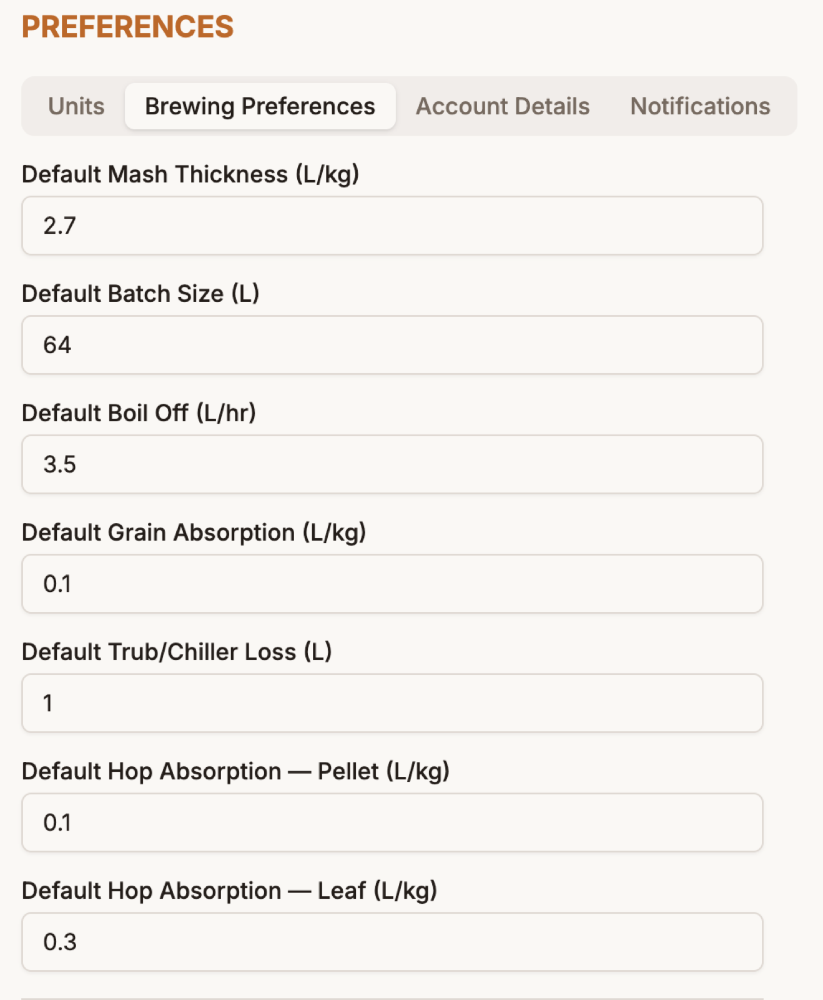
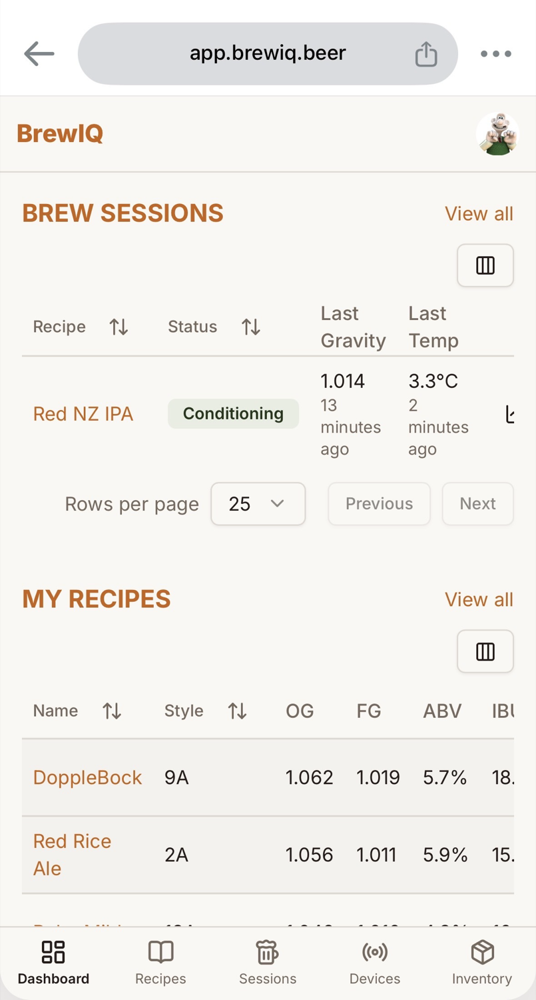
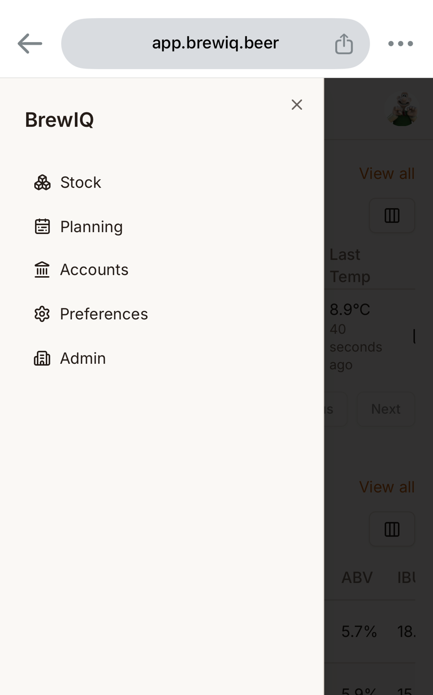
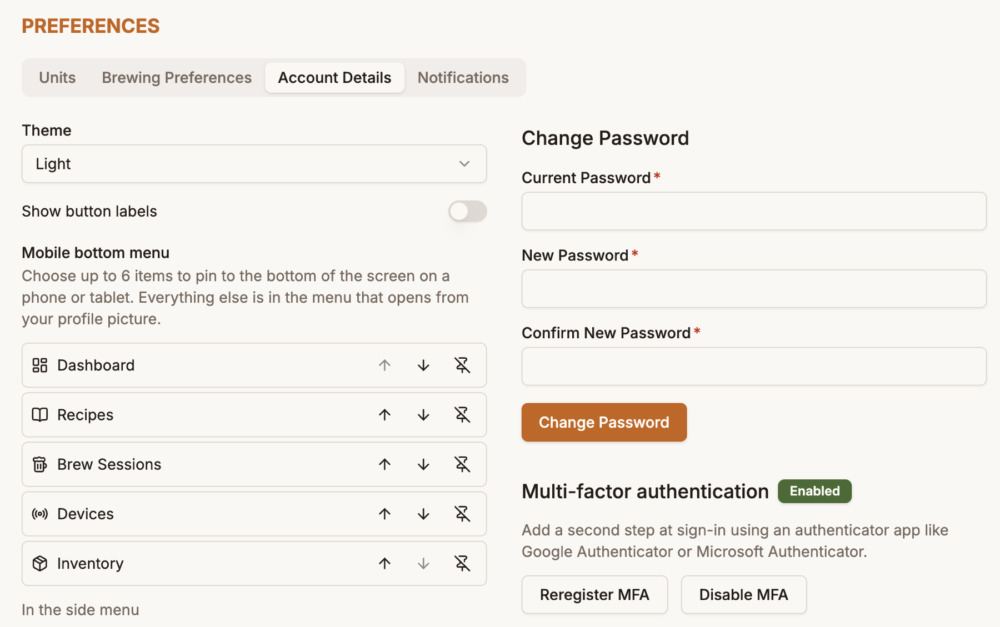
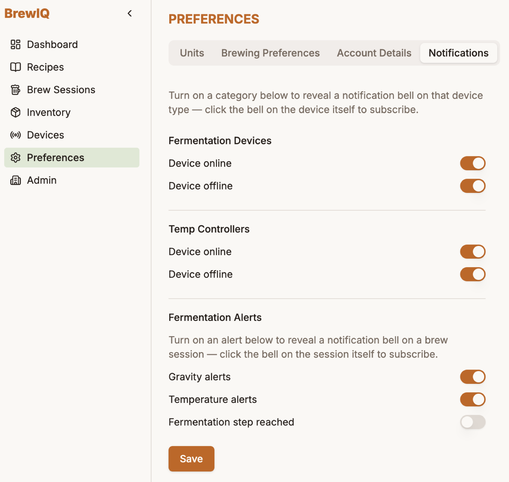

# Account & Preferences

Open **Preferences** from the nav to manage your units, brewing defaults, account details, and notifications, across four tabs.

## Units

- **Unit System** - Metric or Imperial (drives volume/weight display everywhere in the app)
- **Colour Unit** - Lovibond, SRM, or EBC
- **Currency** - NZD, USD, GBP, or EUR
- **Gravity Measurement** - Specific Gravity or Plato

## Brewing Preferences

{ width="380" }

Defaults that pre-fill into new recipes and calculations, in your chosen units:

- Default Mash Thickness
- Default Batch Size
- Default Boil Off (per hour)
- Default Grain Absorption
- Default Trub/Chiller Loss
- Default Hop Absorption - Pellet and Leaf, set separately
- **Fermentation Chart Colours** - pick which colour represents Temp, Gravity, and pH on your fermentation charts

## Account Details

- **Theme** - Light or Dark
- **Show button labels** - on by default, so action buttons show a text label beside their icon. Turn it off for a more compact, icon-only layout.
- **Mobile bottom menu** - see below
- **Profile Picture** - upload a square PNG or JPEG (up to 500KB)
- **Display Name**
- **Email** - changing this requires your current password, and doesn't take effect until you click the confirmation link BrewIQ sends to the new address
- **Change Password** - current password plus a new one, entered twice
- **Multi-factor authentication** - enable, reregister (for a new device), or disable MFA; see [Getting Started](getting-started.md) for the full setup walkthrough
- **Trusted devices** - the browsers you've chosen to trust at sign-in, so they skip the MFA code; revoke any you no longer use (see [Trusted devices](getting-started.md#trusted-devices))

### Mobile bottom menu

On a phone or tablet, BrewIQ shows a row of shortcuts along the bottom of the screen - for example Dashboard, Recipes, Sessions, Devices and Inventory.

{ width="300" }

Everything that isn't on the bar lives in the **side menu**, which opens when you tap your profile picture in the top-right corner.

{ width="300" }

You choose which items sit on the bottom bar from **Account Details**:

{ width="520" }

Pick **up to 6** items to pin, and reorder them with the **up/down arrows**. Use the pin icon to unpin an item or pin one from the **In the side menu** list below. Everything not pinned lives in the menu that opens when you tap your profile picture. Items you don't have permission to use never appear. If you've never customised it, you get a sensible default layout.

## Notifications

Only visible if your role has notification permissions. Turning on a category here reveals a bell icon in the corresponding place in the app - you still have to click that bell on the specific device or session you want to be alerted about:

- **Fermentation Devices** - device online / device offline
- **Temp Controllers** - device online / device offline
- **Data Forwarders** - forwarder disabled (the bell then appears in a forwarder's dialog on the [Devices](devices.md#forwarding-readings-to-other-platforms) page)
- **Fermentation Alerts** - gravity alerts, temperature alerts, fermentation step reached (bells appear on individual [brew sessions](brew-sessions.md)):
    - **Gravity alerts** email you as fermentation finishes. You get one email when gravity reaches the recipe's final gravity but is still falling quickly ("FG reached, still fermenting"), and another when it has levelled off ("fermentation appears complete"). They only apply during Primary Fermentation, and they judge the trend over the last few hours of readings, so one odd reading won't trigger them.
    - **Temperature alerts** email you when the fermenter goes below or above its ideal range. The **Accepted variance (±°C)** setting controls how wide that range is around the target temperature. It starts at ±1°C, accepts 0.1 to 10, and also sets the "ideal range" shown on the session's gauges, so what you see on screen matches when you're emailed. Because it's a personal setting, two people subscribed to the same session can have different ranges.
    - **Fermentation step reached** emails you when the schedule moves on to its next step.

## Managing a brewery's team

If you administer your brewery's BrewIQ account - inviting teammates, assigning roles, resetting someone's password or MFA - that's handled from a separate **Admin** area. See [Tenant Administration](tenant-administration.md).
