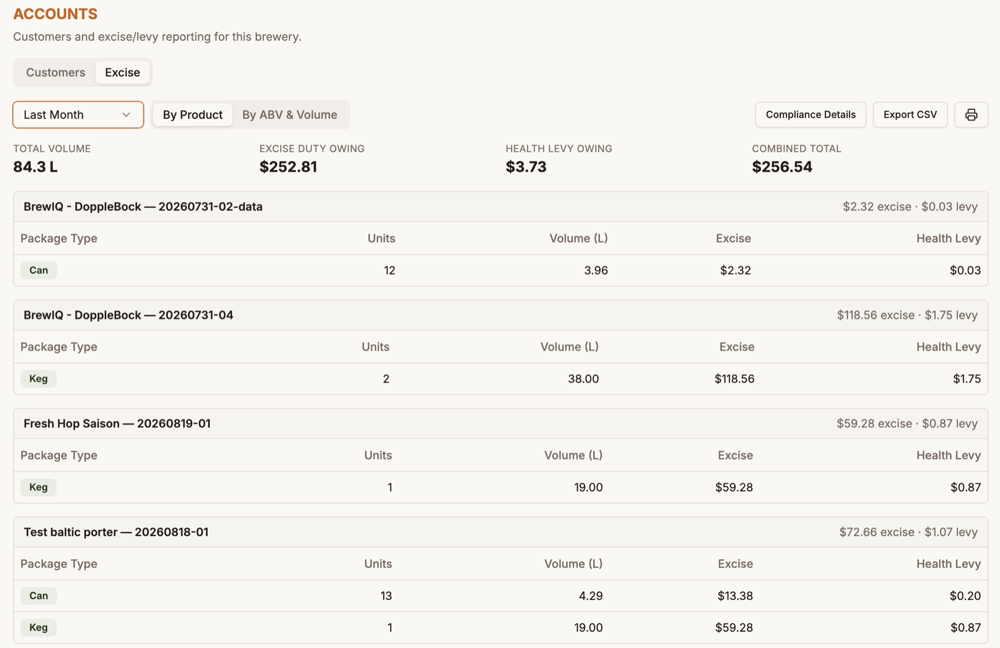
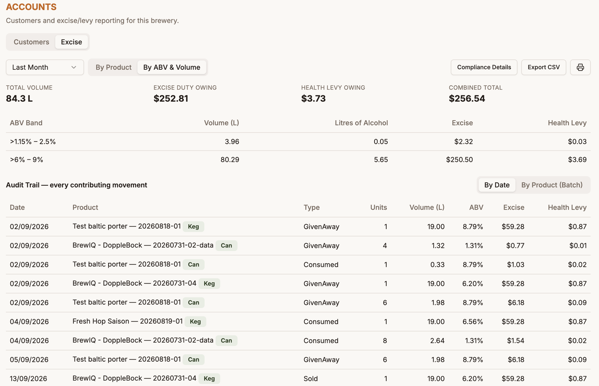
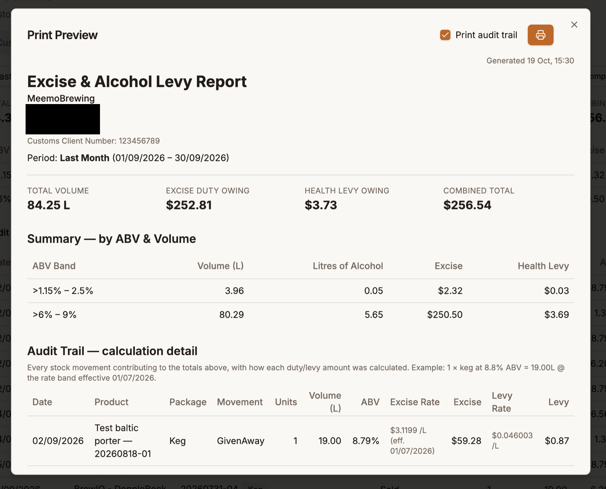

# Accounts

**Accounts** is for commercial breweries. It holds your **customers** and your **excise duty and alcohol levy reporting**. It only appears for **Commercial** accounts (not Homebrewer accounts) whose role has accounts permissions, so you can give a bookkeeper or auditor access to Stock and Accounts only, without exposing recipes or brewing.

It has two tabs: **Customers** and **Excise**.

## Customers

Keep a list of the people and businesses you sell to. Click **Add Customer** and fill in a **Name** (required) plus optional contact name, email, phone, address, and notes. Customers can be edited and archived, and archived ones can be shown from the same page.

Customers appear in the **Customer** picker when you record a **Sold** movement on a stock item (see [Stock](stock.md#opening-an-item)), so you can see who bought what. Leave it as *Anonymous / cash sale* for sales you don't want to attach to anyone.

## Excise

The **Excise** tab works out the excise duty and the Ministry of Health alcohol levy owing on the beer that left your stock — anything recorded as **Sold**, **Given away** or **Consumed** — for a reporting period.

!!! note "Check the figures"
    The report uses published New Zealand excise bands and the rates in force on the date of each movement. It's a tool to help you prepare, not a substitute for checking your return against the New Zealand Customs Service's own guidance.

### Before you start: compliance details

Click **Compliance Details** and enter your legal entity name, address and **Customs Client Number**. These print at the top of the report.

### Reading the report

Pick a period from the dropdown at the top-left (for example **Last Month**). The summary row shows **Total Volume**, **Excise Duty Owing**, **Health Levy Owing** and the **Combined Total**.

Then choose how to group it:

**By Product** lists each beer and batch, broken down by package type, with units, volume, excise and levy.

**By ABV & Volume** groups the litres into the duty bands used for filing — such as ">1.15% – 2.5%" and ">6% – 9%" — with volume, litres of alcohol, excise and levy for each band. Below it, the **Audit Trail** lists every individual movement that contributed to the totals, by date or by product (batch).

### Where the ABV comes from

Duty depends on each batch's ABV. BrewIQ uses the batch's **Final ABV**, which you confirm on the session's Packaging tab (see [Final ABV](brew-sessions.md#final-abv)). It's calculated from your real gravity readings where possible and falls back to the recipe's estimate when there aren't enough readings.

### Printing and exporting

- **Export CSV** downloads the report data.
- The **print** icon opens a **Print Preview**. Tick **Print audit trail** to include a calculation-detail table showing, for every movement, the rate that applied and how the amount was worked out.

