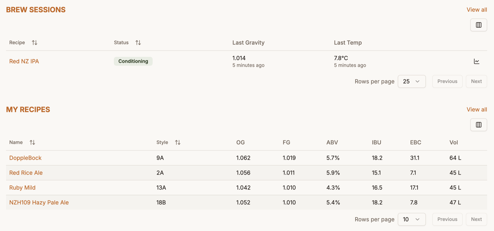
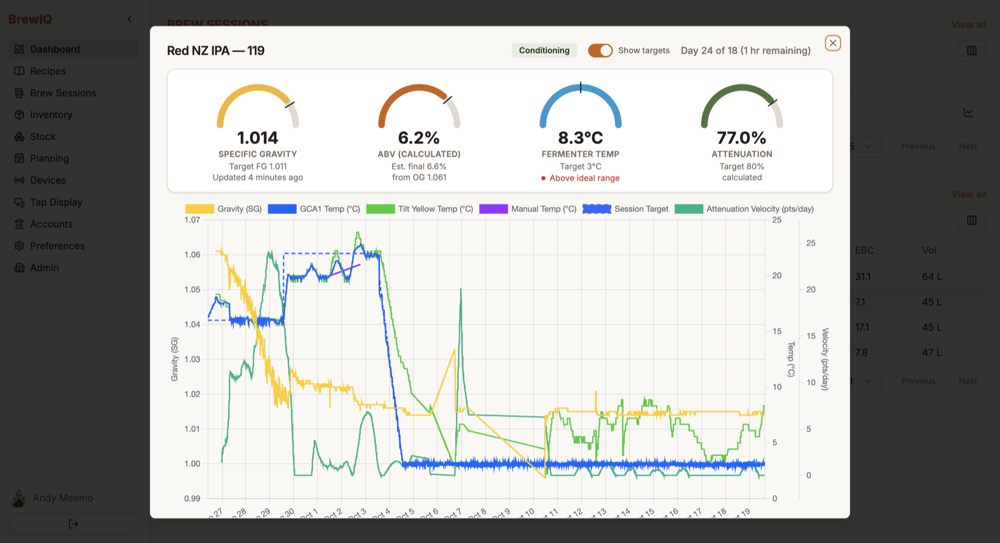

# Dashboard

The Dashboard is the first screen you land on after signing in. It's a quick-glance summary - not the full list - of what's active right now, with links out to the complete views.

It's built from two sections. Which ones you see depends on your permissions (a brewery admin can restrict what roles can view).

## Brew Sessions

Shows your **active** brew sessions only - anything with status *Planning* or *Packaged* is left off the dashboard (those live on the full [Brew Sessions](brew-sessions.md) page). So you can see how each ferment is going without opening it, each entry shows:

- **Recipe** - links to the session detail page
- **Status** - the current stage as a badge
- **Last Gravity** and **Last Temp** - the most recent readings, each with how long ago it arrived (for example "5 minutes ago"). They are tracked separately because a temperature controller and a gravity device report on their own schedules.

**Batch Number** and **Brew Date** are also available. The **Columns** button above the table shows or hides any column, and BrewIQ remembers your choice.

If a session has fermentation readings logged, a small line-chart icon appears - click it to pop open a fermentation graph dialog without leaving the dashboard.

The dialog opens with four gauges - **Specific Gravity**, **ABV (calculated)**, **Fermenter Temp** and **Attenuation** - each showing its target, and the full fermentation chart below. Switch **Show targets** on or off to overlay your session's target values, and the header tells you which fermentation day you're on against the planned schedule (for example "Day 3 of 18") and how long remains.

If the session still has planned steps ahead, a **Show full schedule** switch zooms the chart out to the whole plan. Beside the day count, a small icon shows how the current step was reached: a **clock** means it ran its planned time, a **robot** means it advanced automatically on a gravity condition, and a **hand** means someone skipped or rewound to it. Hover over the icon for the time. It disappears once the session reaches Conditioning.

Use the toggle in the top-right to switch between **table** and **card** view. "View all" takes you to the full, filterable Brew Sessions list.

If you have no brew sessions yet, the dashboard tells you to start one from a recipe's **"Brew it!"** action (see [Recipes](recipes.md)).

## My Recipes

Shows your 4 most recent recipes, as either a table or cards (same view toggle). Each one shows its key stats at a glance:

- **Style** - the BJCP style code
- **OG** / **FG** - original and final gravity, in your chosen gravity unit
- **ABV**
- **IBU**
- **Colour** - in your chosen colour unit (the screenshot above uses EBC)
- **Vol** - batch size, in your preferred units (metric/imperial)

Units are set in [Account & Preferences](account-preferences.md). As with brew sessions, the **Columns** button shows or hides columns.

Clicking a recipe name opens a read-only preview dialog (the same print/preview view used elsewhere in the app), with an **Edit** button to jump into the recipe builder. "View all" goes to the full Recipes page.

If you have no recipes yet, there's a direct link to create your first one.
