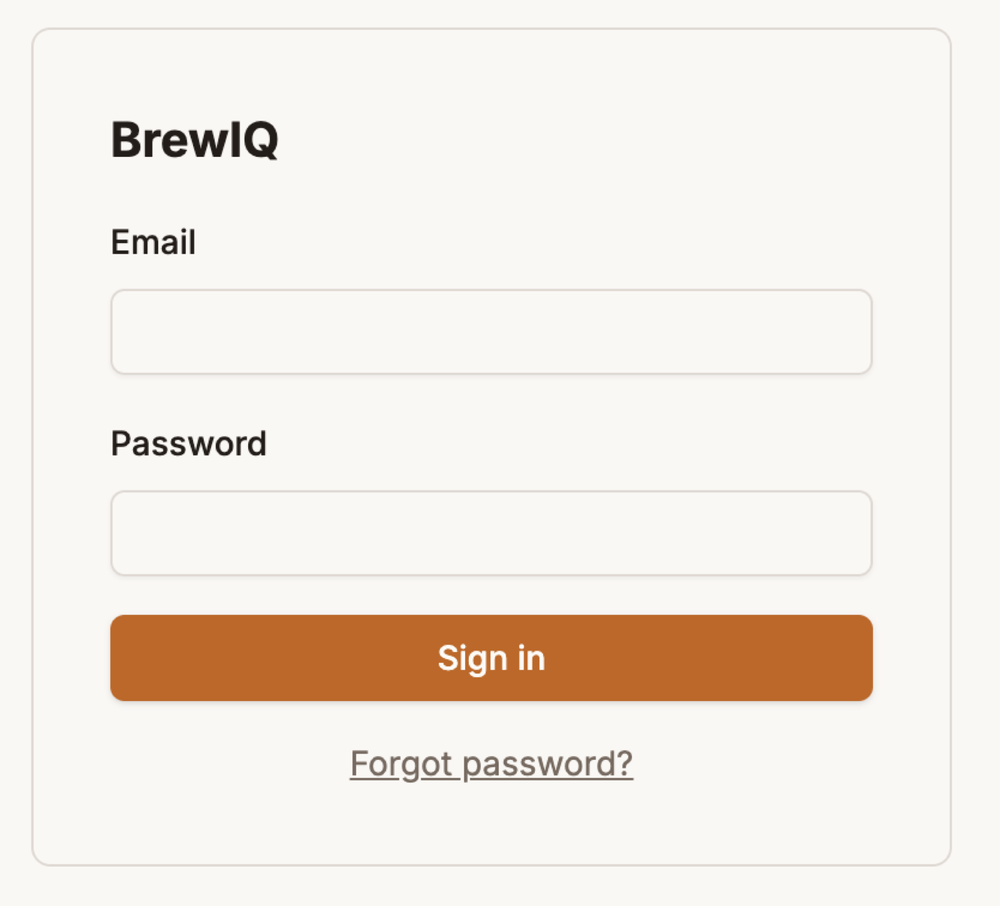
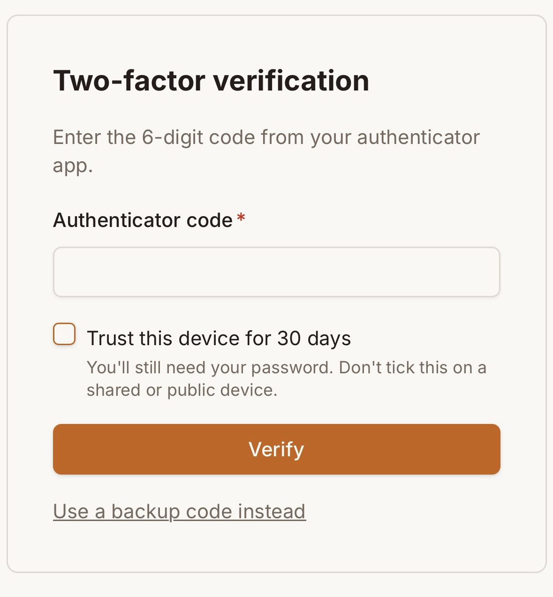
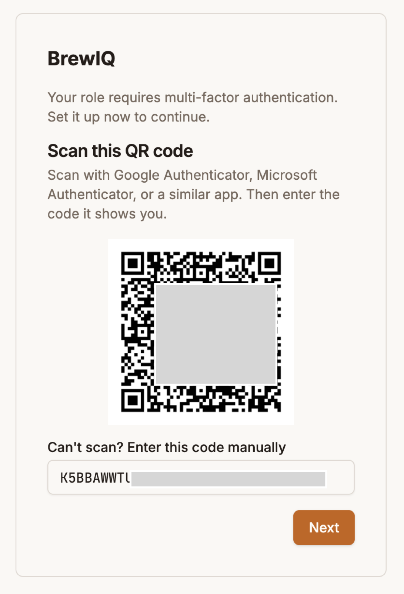
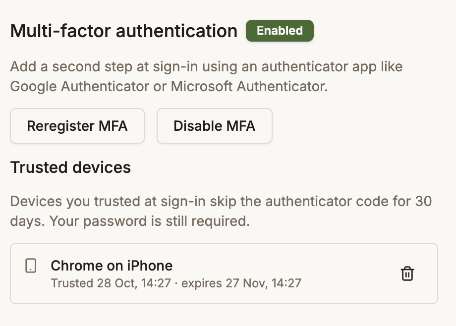
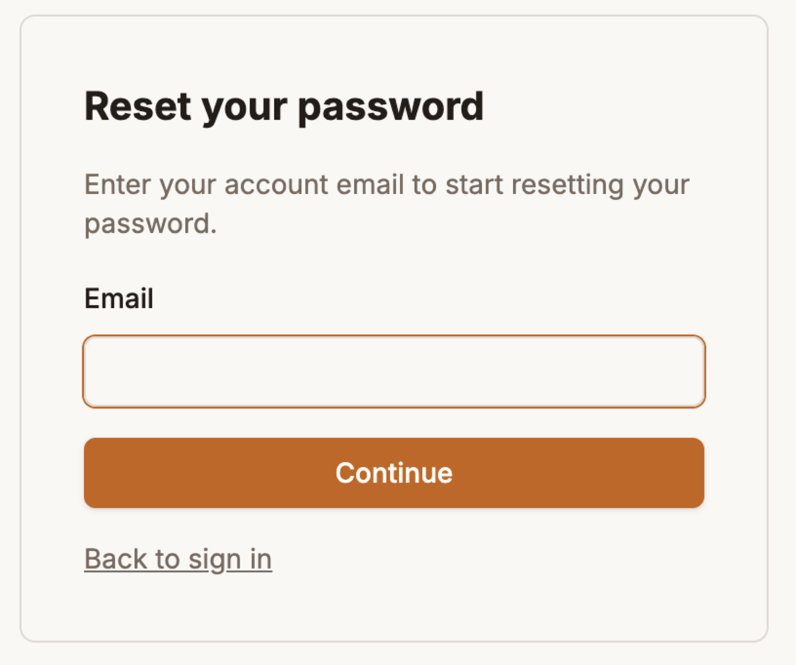

# Getting Started

## Getting an account

BrewIQ is **invite-only** - there's no public sign-up page. Your brewery admin creates your account from Tenant Admin → Users (see [Tenant Administration](tenant-administration.md)), and you'll get an email invitation with a link that's valid for **72 hours**.

Click the link and you'll be asked to:

1. Set a password (entered twice, to confirm)
2. Click **Activate account**

You'll then be signed in automatically and - depending on your role - walked straight into setting up two-factor authentication (see below).

If your invite link has expired, ask your admin to resend it from the Users tab.

## Signing in

{ width="320" }

Go to the login page and enter your **Email** and **Password**, then **Sign in**. There's no "remember me" option - sessions time out after a period of inactivity set by your admin.

If your account has two-factor authentication enabled, you'll be prompted for a second step after your password: a 6-digit code from your authenticator app, or **Use a backup code instead** if you don't have your app handy.

{ width="320" }

On your own phone or computer, tick **Trust this device for 30 days** before you click **Verify**. For the next 30 days, signing in on that browser only needs your password - no code. This is handy on a phone using mobile data, where your network address keeps changing and a [trusted IP range](tenant-administration.md#trusted-ips) can't help. Don't tick it on a shared or public device.

A few things to know:

- Your **password is always still required** - trusting a device only skips the code.
- The 30 days count from when you ticked the box. Signing in again doesn't extend it - when it runs out, you'll be asked for a code once more and can trust the device again.
- Trust belongs to that one browser. A different browser on the same phone, a private/incognito window, or clearing your cookies all mean you'll be asked for a code.
- Your admin may set a shorter length, or turn the option off - if it's off, you won't see the checkbox.

Forgotten your password? Click **Forgot password?** on the login screen - see below.

## Two-factor authentication (MFA)

MFA is optional by default, but some roles require it - if yours does, you'll be walked into setup automatically the first time you sign in and can't skip it.

**Setting it up:**

{ width="320" }

1. Scan the QR code with an authenticator app (Google Authenticator, Microsoft Authenticator, or similar). Can't scan? There's a manual entry code shown alongside it.
2. Enter the 6-digit code your app is now showing, and click **Activate**.
3. You'll be shown a set of **backup codes** - save these somewhere safe. Each one can be used once to sign in if you lose access to your authenticator app, and they're only shown this one time.

You can manage MFA any time from [Account & Preferences](account-preferences.md) - enable it if it's optional, **Reregister MFA** if you're moving to a new device, or **Disable MFA** (both require your password and a current code to confirm).

### Trusted devices

{ width="460" }

Every device you've trusted is listed under **Trusted devices** in [Account & Preferences](account-preferences.md), with when you trusted it, when it expires, and when it was last used. The one you're using right now is marked **This device**. Click the bin icon to stop trusting a device (or **Revoke all** if you have more than one) - it'll need a code at its next sign-in.

BrewIQ also clears all your trusted devices automatically when you change or reset your password, or reregister or disable MFA. If you lose a phone you'd trusted, revoke it here (or ask your admin to) and change your password.

## Forgotten password

{ width="320" }

Click **Forgot password?** and enter your email. What happens next depends on whether MFA is already set up on your account:

- **MFA enabled** - enter a code from your authenticator app, and BrewIQ emails you a reset link (valid for 1 hour). Follow it to set a new password.
- **MFA not enabled** - self-service reset isn't available; you'll need to ask your admin to reset your password for you.

This is why it's worth setting up MFA early - it's what makes self-service password recovery possible.

## Signed in with a temporary password

If an admin created your account with a temporary password, or reset your password for you, you'll be required to set a new one the first time you sign in before you can do anything else in the app.

## Changing your email

If you change your email address yourself (from Account & Preferences), the change doesn't take effect immediately - BrewIQ sends a confirmation link to the *new* address, and you keep signing in with your old email until you click it.

## Getting help

Click **Help** in the left menu (just below **Admin**) to open this guide in a new tab. It opens at the page for whatever you're looking at in BrewIQ - from **Recipes** you land on [Recipes](recipes.md), from a brew session on [Brew Sessions](brew-sessions.md). On pages with tabs it goes straight to that tab's section, for example **Devices** with the **Temp Control** tab open takes you to [Temp Control tab](devices.md#temp-control-tab).

On a phone, tap your profile picture at the top right to open the menu - **Help** is listed there.
