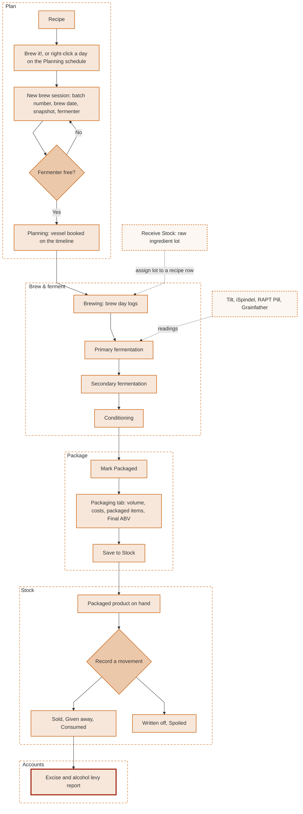

# Batch Lifecycle

This is the life of one batch, from recipe through to the excise report, and where each step is covered in these docs. Click any box to jump to it.

## Reading the diagram

- A fermenter has to be free before a session can be created. BrewIQ checks this on the new-session page, and can book the vessel on the [Planning](planning.md) timeline.
- Stock is only created by the explicit **Save to Stock** step on the Packaging tab. It never happens automatically.
- Only **Sold**, **Given away** and **Consumed** movements feed the [excise report](accounts.md#excise). **Written off** and **Spoiled** do not.
- Raw ingredient lots are received separately on the [Stock](stock.md#raw-materials) page and assigned to a session's ingredient rows. Fermentation readings come from linked [devices](devices.md).
