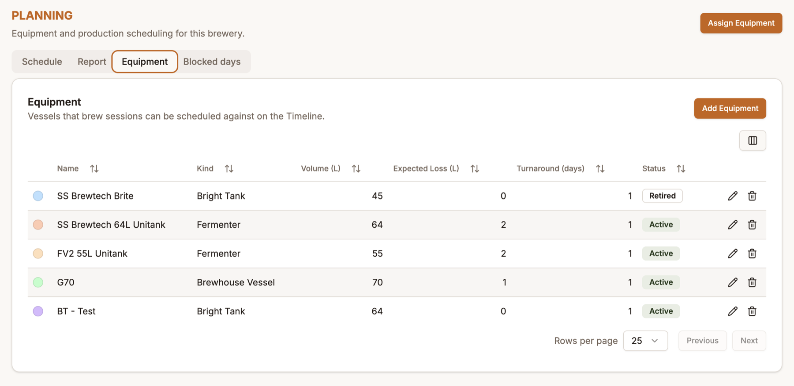
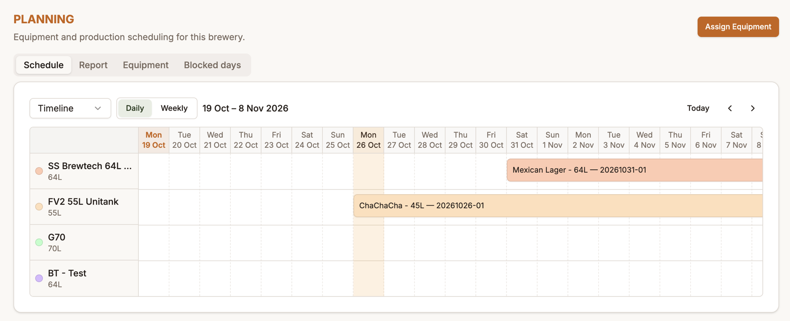
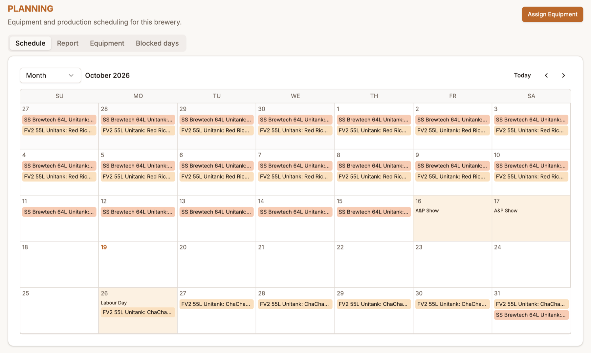
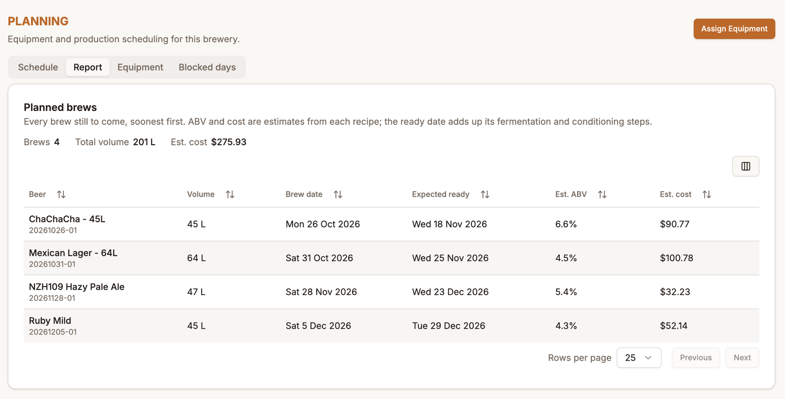
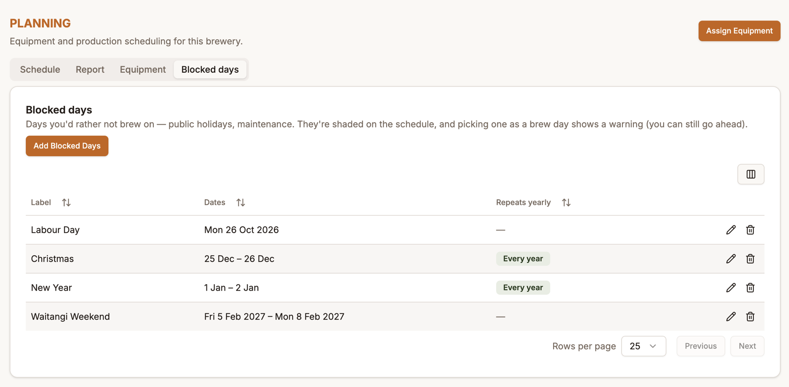

# Planning

The **Planning** page shows your brewery's equipment and what's scheduled to occupy it. Use it to see whether a fermenter is free on a given date, to avoid double-booking a vessel, and to see what's coming up.

It has four tabs: **Schedule**, **Report**, **Equipment** and **Blocked days**. You'll need planning permissions to see the page (see [Tenant Administration](tenant-administration.md)).

## Setting up equipment

Before you can schedule anything, add your vessels on the **Equipment** tab.

Click **Add Equipment** and fill in:

- **Name** and a **Kind** — Fermenter, Bright Tank, Brewhouse Vessel or Keg
- **Volume** (litres)
- **Expected Loss** (litres) — what you typically lose to trub when transferring out
- **Turnaround (days)** — how long cleaning and changeover takes after a batch
- A **colour**, used for its bars on the schedule

Each vessel shows as **Active** or **Retired**. Use the pencil to edit one. A vessel that's been used can't simply be deleted, so mark it **Retired** to take it out of the pickers while keeping its history.

## The Schedule

The **Schedule** tab has two views, chosen from the dropdown at the top-left. BrewIQ remembers your choice on that browser.

- **Timeline** — one row per vessel, one column per day, with each batch drawn as a bar showing how long it occupies the vessel. Switch between **Daily** and **Weekly** scale to zoom out. Today is highlighted.
- **Month** — a calendar, with each day listing the batches occupying vessels.

Use the **‹ ›** arrows and **Today** to move around. Hover or click a bar to see its details.

### How long does a batch occupy a vessel?

When a batch is assigned to a vessel, the booking runs from the brew date for the total length of the recipe's fermentation steps, plus that vessel's turnaround days. The turnaround is a soft buffer: a new batch is allowed to start on the same day the previous one finishes (the old beer goes out and the vessel is cleaned while the new brew is underway), so two bars may touch on the timeline without it counting as a clash.

If a vessel is already booked, BrewIQ won't let you double-book it.

### Assigning equipment

Click **Assign Equipment** (top-right) to book a vessel for a brew session, or assign equipment at the moment you create a session — see [Starting a session](brew-sessions.md#starting-a-session).

A beer that conditions in its fermenter takes a single booking. If it's transferred to a separate vessel for conditioning (for example a bright tank), it gets a second booking after the first.

### Moving and rescheduling

You can drag a booking to reschedule it:

- Drag **sideways** to change the date. Moving a batch's main booking also moves the brew date of the session (and its date-based batch number, unless you've set the batch number by hand).
- Drag **up or down** onto another vessel's row to move it to a different vessel.

A booking **locks** once its brew day has passed and there's real activity on the session (a brew log or a fermentation reading). Locked bookings can't be moved or cancelled, because the batch is no longer a plan.

### Starting a brew from the schedule

Right-click a day on the timeline or month view and choose **New brew session** to pick a recipe from a searchable list. You're taken to the usual new-session page with the date (and, from a fermenter's row, the fermenter) already filled in.

## Report

The **Report** tab lists **every brew still to come, soonest first**: the beer and batch number, volume, brew date, **expected ready** date, estimated ABV and estimated cost. Above the table it totals the number of brews, total volume and estimated cost.

ABV and cost are estimates calculated from each recipe, and the ready date adds up all of its fermentation and conditioning steps. A brew whose date has already passed drops off the report. Sort any column by clicking its heading.

## Blocked days

Mark the days you'd rather not brew on — public holidays, maintenance, trade shows — on the **Blocked days** tab. Click **Add Blocked Days**, give it a **label**, a date or date range, and tick **Repeats yearly** for fixed-date holidays such as Christmas.

Blocked days are shaded on the schedule. They're a warning, not a rule: picking a blocked day as a brew day shows a warning, and dragging a brew onto one asks you to confirm, but you can always go ahead. They apply to the whole brewery rather than to one vessel. Holidays that move each year (like Easter) need a new entry each year.
