# Recipes

## The Recipes list

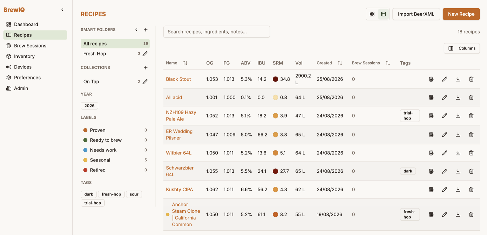

Switch between **Card view** and **Table view** with the toggle in the top-right. The table view shows OG, FG, ABV, IBU, SRM, batch volume, created date, and a **Brew Sessions** count you can click to jump straight to the sessions brewed from that recipe.

Search matches recipe name, notes, and any ingredient name - try `Search recipes, ingredients, notes...` for things like "citra" to find every recipe using a particular hop.

### Organizing recipes

The left rail gives you four ways to organize a growing recipe list:

- **Smart folders** - rule-based, auto-updating. Build rules against ABV, IBU, SRM, brew session count, created year, or tag (e.g. "ABV at least 6" AND "Tag is hazy"), and any recipe matching the rules appears automatically - including ones you add later.
- **Collections** - a static, hand-picked list of recipes (no rules), good for things like "Summer 2026 lineup."
- **Labels** - five fixed status tags: **Proven, Ready to brew, Needs work, Seasonal, Retired**. A recipe can carry more than one at a time, shown as colored dots. (A brewery admin can rename these slots in Tenant Admin.)
- **Tags** - free-text, tenant-wide tags you create yourself.

To label or tag a recipe, **right-click** it (in either table or card view) to open the organize menu - click a label to toggle it, or type into "Add tag..." and press Enter. Changes save instantly.

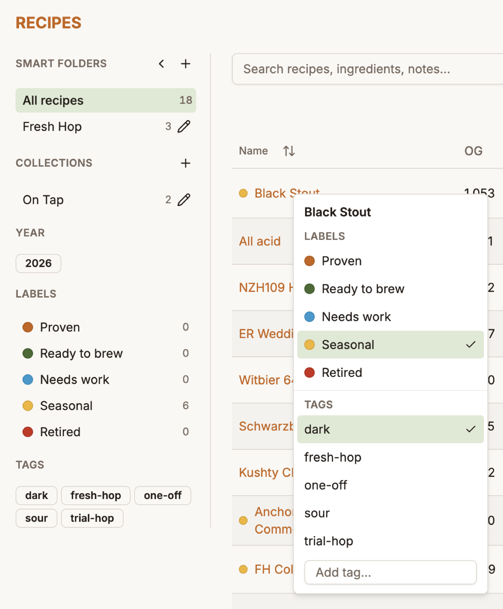{ width="380" }

Filters (folder, year, label, tag) show as removable chips above the list; use **Clear all** to reset.

### Importing and exporting

**Import BeerXML** (top of the list page) accepts up to 5 `.xml` files at once, shows you a preview of what it found per file, and lets you deselect anything you don't want before committing. Rows with errors are shown dimmed and excluded automatically.

Ingredients that don't match anything in your Inventory come in unlinked. You can match each one from the recipe builder - see [Prices, refreshing and matching ingredients](#prices-refreshing-and-matching-ingredients).

Each recipe row also has an **Export** (download) icon that downloads it as a standalone BeerXML file - handy for backups or moving a recipe to another tool.

## Building a recipe

Click **New Recipe**, or click a recipe name to reopen the builder on an existing one.

### The builder header

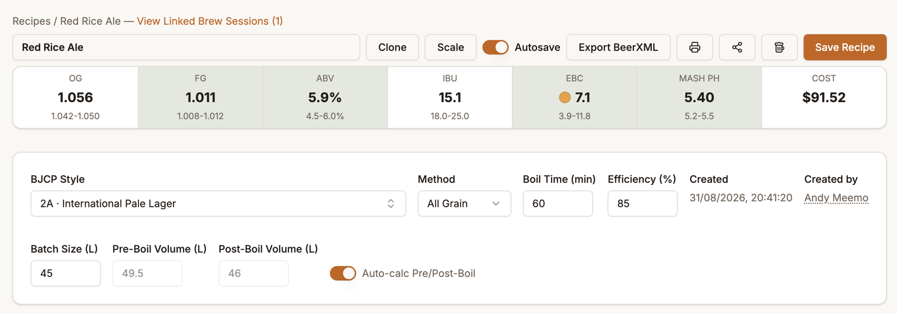

The top row holds the recipe's name and its actions. Above it, **View Linked Brew Sessions** takes you to the sessions brewed from this recipe.

- **Clone** - makes an independent copy to work on. BrewIQ asks you to name it first.
- **Scale** - resizes the whole recipe to a new batch volume or ABV (see [Scaling a recipe](#scaling-a-recipe)).
- **Autosave** - the on/off switch described under [Saving](#saving).
- **Export BeerXML** - downloads the recipe as a BeerXML file.
- **Print**, **Share** and **Brew it!** - open the print preview, the share dialog, and the new brew session screen. They show as icons only if you've turned off **Show button labels** in [Account & Preferences](account-preferences.md).
- **Save Recipe** - saves your changes now.

### Recipe Details

At the top: **BJCP Style** (searchable dropdown of the full BJCP 2021 style list), **Method** (All Grain / Extract / BIAB / Partial Mash), **Boil Time**, **Efficiency %** (your brewhouse efficiency - feeds the OG calculation directly), and **Batch Size** / **Pre-Boil Volume** / **Post-Boil Volume**. A saved recipe also shows when it was **Created** and by whom.

Turn on **Auto-calc Pre/Post-Boil** and BrewIQ will keep those two volumes in sync automatically as you change batch size, boil time, or the hop schedule - turn it off if you'd rather set them manually.

### The stat strip

Right under the header buttons, a live strip shows **OG, FG, ABV, IBU, colour, Mash pH, and Cost**, recalculating as you edit. Gravity and colour follow the units you chose in [Account & Preferences](account-preferences.md) (for example EBC or SRM). Once you've picked a BJCP style, each cell also shows that style's target range underneath and highlights green when you're inside it - a quick way to see if your recipe is on-style.

Treat **Mash pH** and **Cost** as directional estimates rather than lab-precision numbers - mash pH is a rule-of-thumb calculation, not a substitute for an actual meter reading.

### Grain Bill, Hop Schedule, Adjuncts, Yeast, Mash & Water, Fermentation, Notes

These are tabs (or view them all stacked at once under the **All** tab):

- **Grain Bill** - click **Add grain** to pull from your [Inventory](inventory.md) (there are separate Grains and Fermentables catalogs, both searchable/tag-filterable from the same dialog). Set the amount per grain; percentage of the grist, colour, and PPG are calculated or pulled in automatically. A running **Total grain bill** shows at the bottom.

    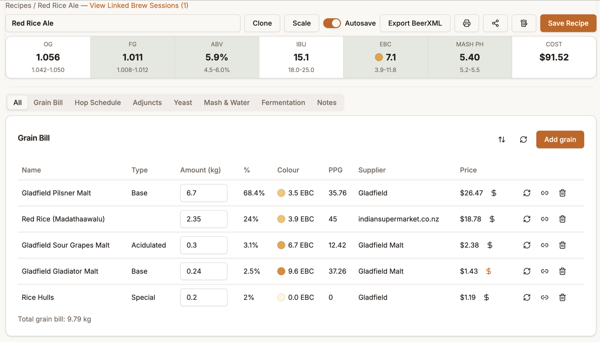

- **Hop Schedule** - click **Add hop**, then set **Usage** (Boil / First Wort / Whirlpool / Mash / Dry Hop), **Form** (Pellet / Leaf / Fresh), **Time**, and **Amount** per addition. Picking Boil or First Wort auto-fills the time to your boil length. The **Alpha %** is editable, so you can correct it to match the actual hops you bought (correcting it also updates the recipe's open snapshotted [brew sessions](brew-sessions.md#recipe-view-tab)). Two read-only columns show the maths for each addition: **Extracted AA%** is how much of that hop's alpha acid ends up in the wort (it depends on time, temperature and gravity, so it doesn't change when you change the amount), and **IBU** is that addition's contribution to the recipe's bitterness (which does scale with amount). Dry hops show 0. A summary at the bottom breaks total hops down by stage (Mash / Boil / Whirlpool / Fermenter) with a density figure so you can sanity-check dry-hop rates.

    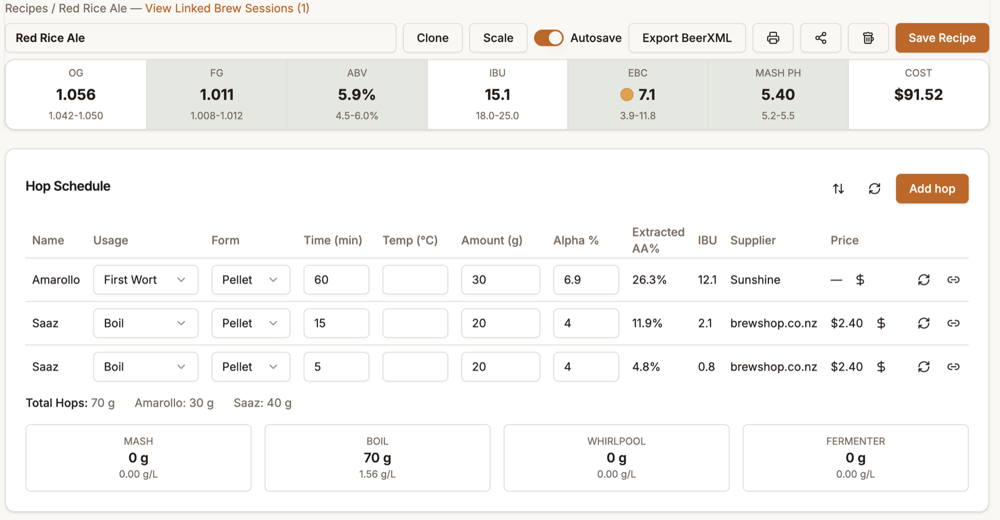

- **Adjuncts** - same add/search flow as grains and hops, with a Usage field (Mash, Sparge, Water correction, Boil, Whirlpool, Fermenter, Other).
- **Yeast** - pick a **Strain** from inventory and BrewIQ fills in supplier, flocculation, temperature range, expected attenuation, and fermentation temp from the strain's data (all still editable). Set **Quantity** and whether a **Starter** was used. Expected attenuation is what drives your FG estimate.
- **Mash & Water** - set your **Mash Thickness** and BrewIQ suggests a **Recommended Mash In** volume (and a **Recommended Sparge** volume, accounting for grain absorption); click **Add to schedule** on either to drop a pre-filled step into the **Mash Steps** table below, which you can then edit freely or build entirely by hand with **Add step**.
- **Fermentation** - plan the batch's temperature schedule, step by step. See [Fermentation steps](#fermentation-steps).
- **Notes** - a plain text field for anything else (process notes, tasting notes, etc.).

Any ingredient you add here comes straight from your ingredient catalog - if something's missing, add it in [Inventory](inventory.md) first.

### Prices, refreshing and matching ingredients

Each grain, hop and adjunct row has a few small tools on the right:

- **$ (cost override)** - set a price for this recipe only. The $ turns orange once a row is overridden. If the same ingredient appears on several rows, tick **Apply to all** to price them together. **Clear** removes the override.
- **Refresh from inventory** (circular arrow) - re-pulls the ingredient's details from [Inventory](inventory.md): colour and PPG for grains, alpha acid for hops, type, supplier, and price. A price you've overridden is left alone. The refresh arrow in the section's top-right corner (**Refresh all from inventory**) does every row at once. Prices in a recipe stay as they were until you refresh, so a change in Inventory never alters a recipe's cost by surprise.
- **Match to inventory** - an ingredient that came from a BeerXML import and doesn't match anything in your Inventory shows a **+** icon. Click it to open a dialog with two tabs: **Match existing** (search your catalogue and pick the right item) or **Add as new** (create an Inventory item, pre-filled from the row). Matching takes the catalogue's name, type, colour or alpha acid, supplier and price, but keeps the amount, usage and timing from your import. For an adjunct, the price is only taken if it is priced in the same unit as the row. A matched row shows a **link** icon, which lets you **Re-match** it to a different item.
- **Remove** (trash) - deletes the row.

The **sort** icon at the top of the Grain Bill and Hop Schedule re-orders the rows: the grain bill largest first (**Sort by % of grain bill**), and hops in the order they go into the process (**Sort by schedule**): Mash, First Wort, Boil (longest time first), Whirlpool, then Dry Hop. Both lists are also sorted automatically every time you save, so a saved recipe is always in brewing order.

### Fermentation steps

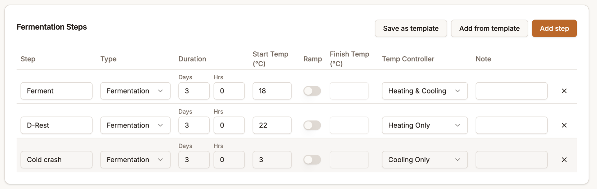

The **Fermentation** tab is where you plan the batch's temperature schedule before you brew. Click **Add step** and fill in each row:

- **Step** - a name, such as Ferment, D-Rest or Cold crash.
- **Type** - **Fermentation** or **Conditioning**. A Conditioning step plans the time the beer spends conditioning.
- **Duration** - days and hours.
- **Start Temp** (°C).
- **Ramp** and **Finish Temp** - switch **Ramp** on and enter a finish temperature to move gradually from the start temperature to the finish temperature over the step. BrewIQ moves the temperature in **0.5°C increments**, holding each for an equal share of the step, instead of a continuous slide. A 20°C to 3°C ramp over 24 hours becomes 34 small steps of about 42 minutes each, which suits a compressor-based controller far better than constant tiny changes.
- **Temp Controller** - the mode to use for that step: Heating & Cooling, Heating Only or Cooling Only.
- **Note**.

When you start a [brew session](brew-sessions.md#fermentation-tab), these steps are copied onto it, whether or not you take a recipe snapshot. Anything that reacts to live readings, such as auto-advance conditions and Managed Mode, is set up on the brew session itself, not on the recipe.

The gauges and alerts on a brew session aim for the temperature of the active step. With no schedule, they use the **fermentation temperature** on the Yeast tab, and failing that the midpoint of the yeast's temperature range.

### Fermentation profile templates

Most of your beers probably share the same fermentation shape - ferment, diacetyl rest, cold crash, condition - with only durations and temperatures changing. Rather than re-typing the steps, use a **fermentation profile**.

- Click **Add from template** above the fermentation steps (on a recipe, or on a [brew session](brew-sessions.md#fermentation-tab)) and pick a profile. If steps already exist you choose **Replace** or **Add to end**.
- Click **Save as template** to turn the steps you've built into a reusable profile.
- Manage them all from the **Fermentation Profiles** tab on the Recipes page, where you can add, edit, clone and delete profiles. Every brewery starts with an editable **Standard** profile (7 days at 18°C, a 2-day rest at 21°C, a 2-day cold crash at 2°C, then 14 days conditioning at 2°C).

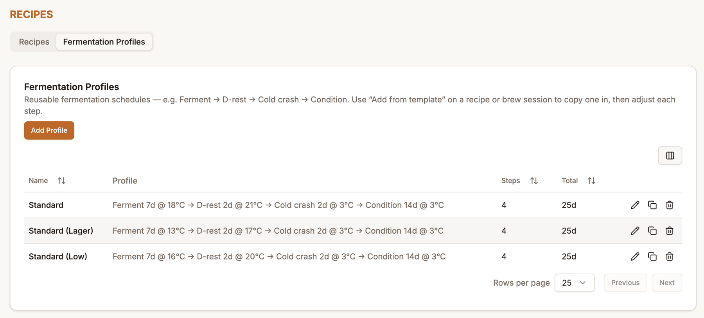

Each profile shows a one-line summary of its steps, how many steps it has and its total length. Use the **pencil** to edit it, the **copy** icon to clone it (handy for making a lager or low-temperature variant) and the **trash** to delete it. **Add Profile** creates a new one.

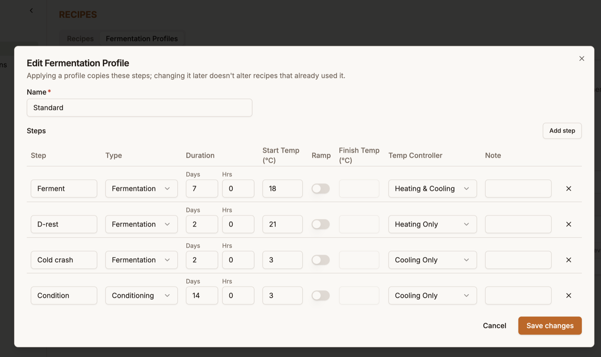

A profile has the same step fields as a recipe's Fermentation tab, without the live-reading automation.

Applying a template copies its steps - it doesn't stay linked, so editing or deleting a template later never changes recipes or sessions that already used it. A step can be marked as a **Conditioning** step; its duration is used for [Planning](planning.md) (how long a vessel is occupied), but it never drives a temperature controller before the session actually reaches Conditioning.

### Saving

**Save Recipe** commits your changes immediately. **Autosave** (on by default, toggle in the header) saves every 60 seconds while you have unsaved changes - there's no on-screen warning if an autosave fails, so if you're making a big change, it's worth hitting Save manually before navigating away.

There's no version history - Save simply overwrites the recipe. If you want to branch off a variant without touching the original, use **Clone** in the header to create an independent copy first.

### Scaling a recipe

Click **Scale** in the header to resize the recipe.

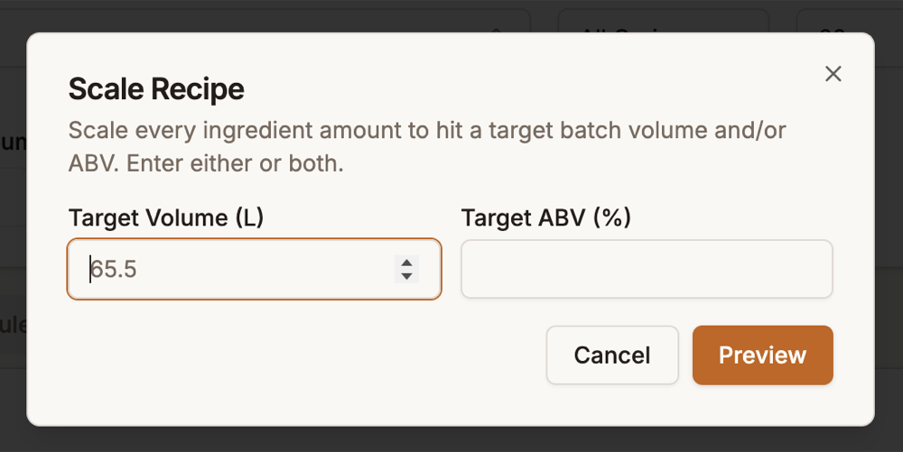{ width="460" }

Enter a **Target Volume**, a **Target ABV**, or both, and click **Preview**. BrewIQ shows a **Scaled result** with the new batch size, OG, FG, ABV, IBU and colour so you can check it before you commit. Click **Apply to Recipe** to scale the amounts:

- Changing the **volume** multiplies every grain, hop and adjunct amount, the mash water and the batch, pre-boil and post-boil volumes by the same factor.
- Changing the **ABV** adjusts the grain bill to reach that strength and scales the hops and adjuncts with it, so the balance of bitterness to gravity is kept.

Applying a scale only changes the recipe you have open. Nothing is stored until it is saved, either with **Save Recipe** or by autosave, so use **Clone** first if you want to keep the original.

### Brewing from a recipe

Click **Brew it!** (in the builder header, the list row actions, or the print preview) to start a new [brew session](brew-sessions.md) from that recipe.

### Print Preview

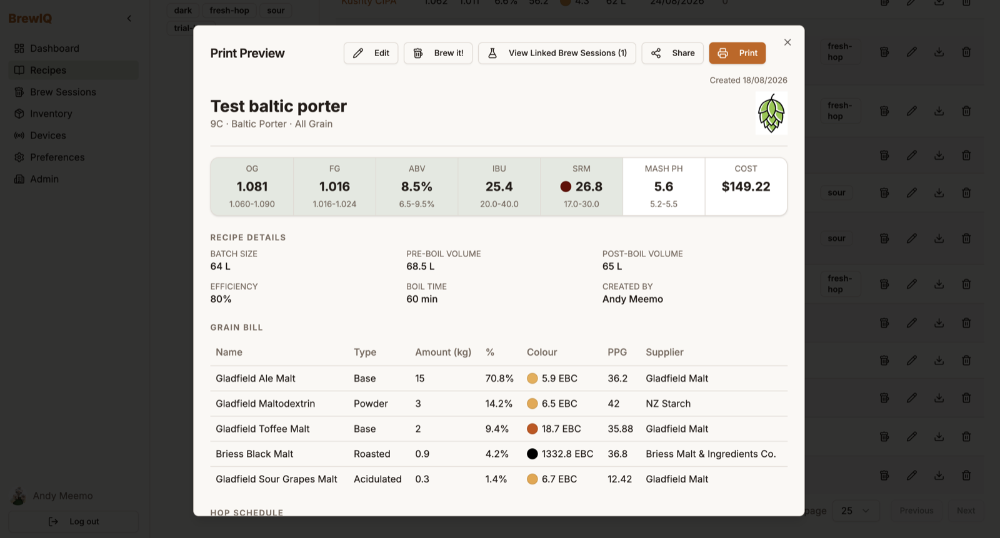

**Print** opens a clean, printable one-page view of the recipe - details, stat strip, and every ingredient section - with **Edit**, **Brew it!**, **Share**, and a link to any linked brew sessions right in the dialog header.

## Sharing a recipe

Click **Share** (in the builder, the print preview, or a recipe's row) to open **Share Recipe**. Choose a duration (hours or days, up to 60 days) or check **Share Permanently**, then **Create Share Link**.

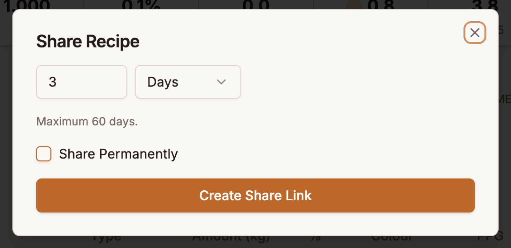{ width="420" }

You get:

- A public link (`.../share/{token}`) with a **Copy Link** button
- A QR code - click it to copy the image to your clipboard (it downloads as a PNG instead if your browser/connection doesn't support clipboard images)

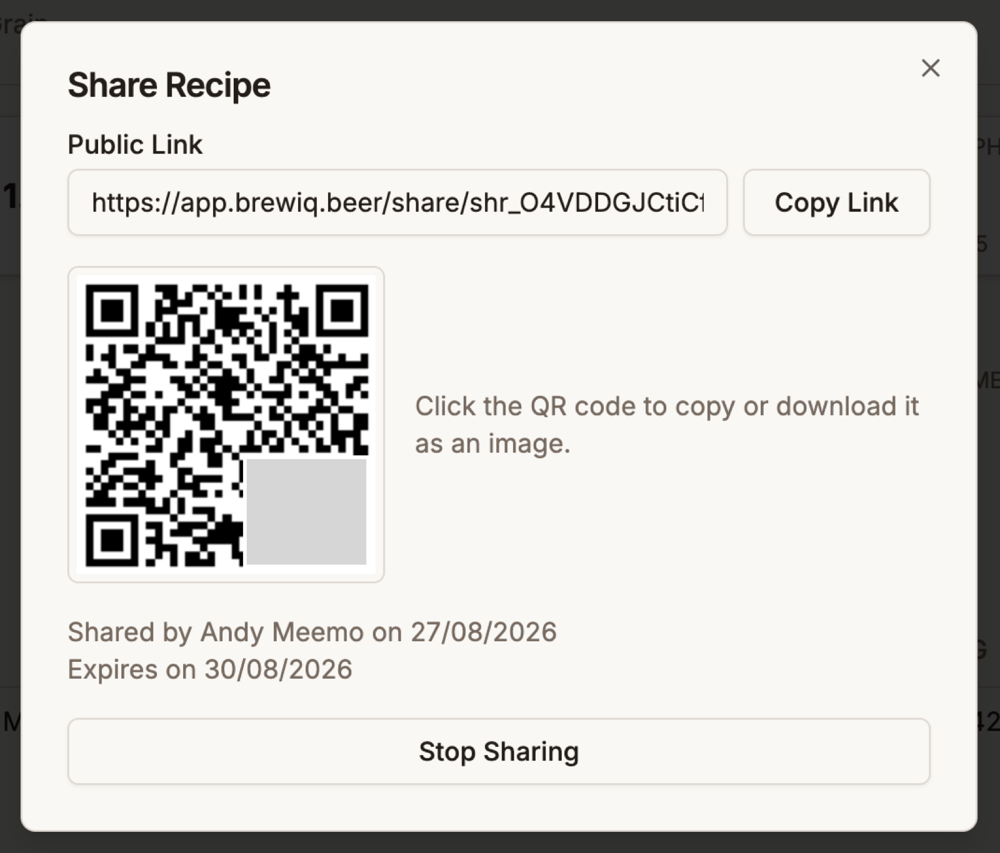{ width="420" }

If the recipe has a brew session in progress (from Brewing through to Conditioning), the dialog also offers **Share fermentation data (active brew session)**. It's off by default. When it's on, the public page shows an **Active fermentation session** chart above the recipe. It follows whichever session is active when someone opens the link, and it never shows the batch number, notes, vessel or any automation settings.

A recipe only has **one active share link at a time** - creating a new one replaces the old, and **Stop Sharing** revokes it immediately. Anyone with the link can view a read-only version of the recipe with no login required - cost and pricing information is left out of the public view.

If a link is revoked or expired, visitors see: *"This link has expired or is no longer available."*
