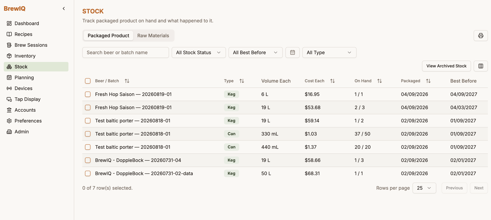
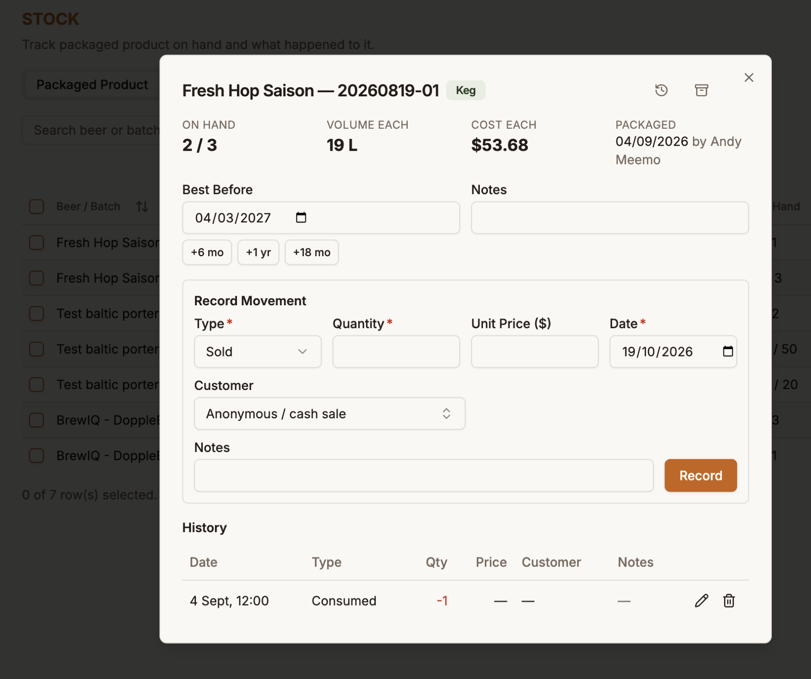
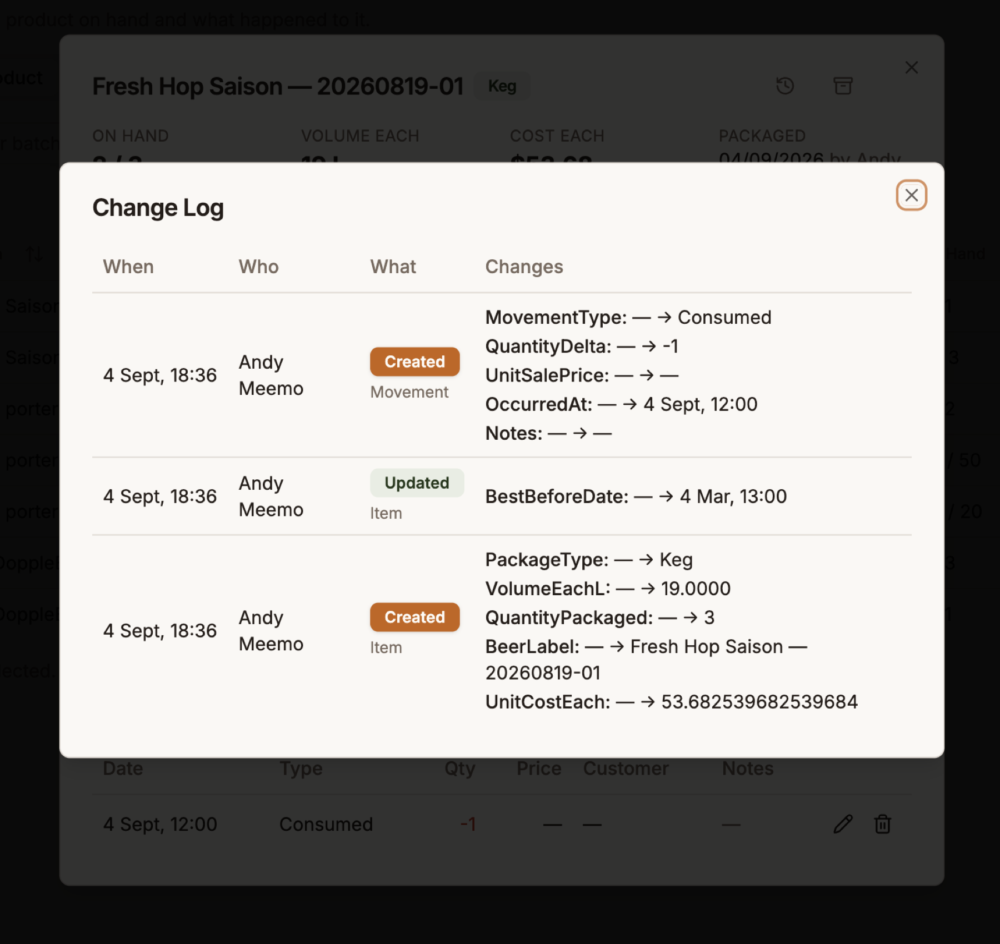
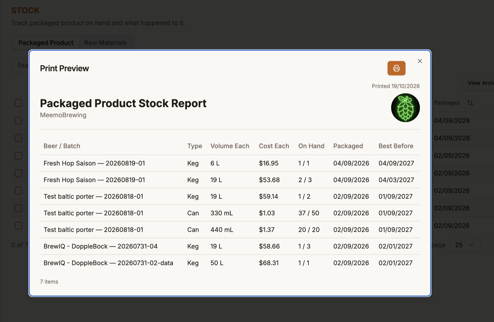
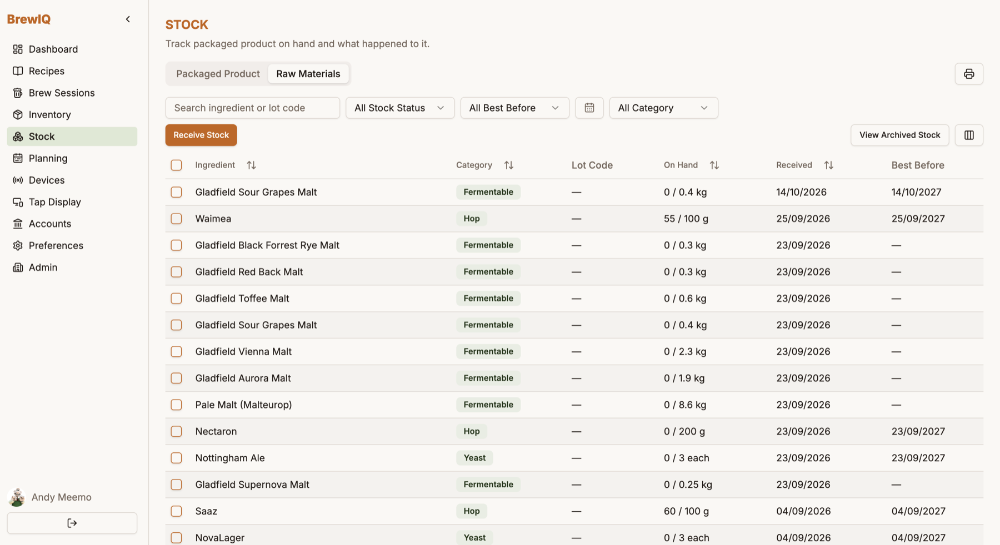
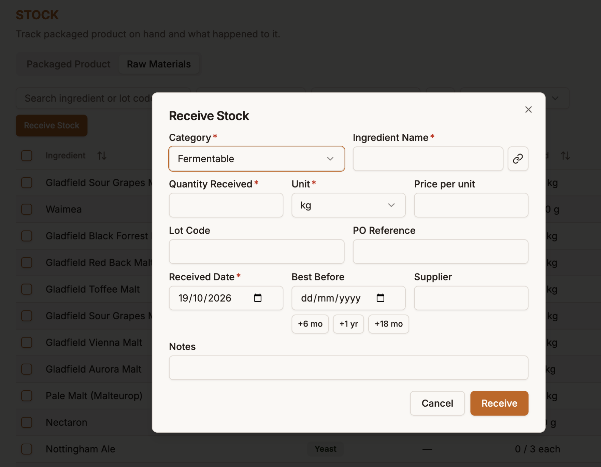
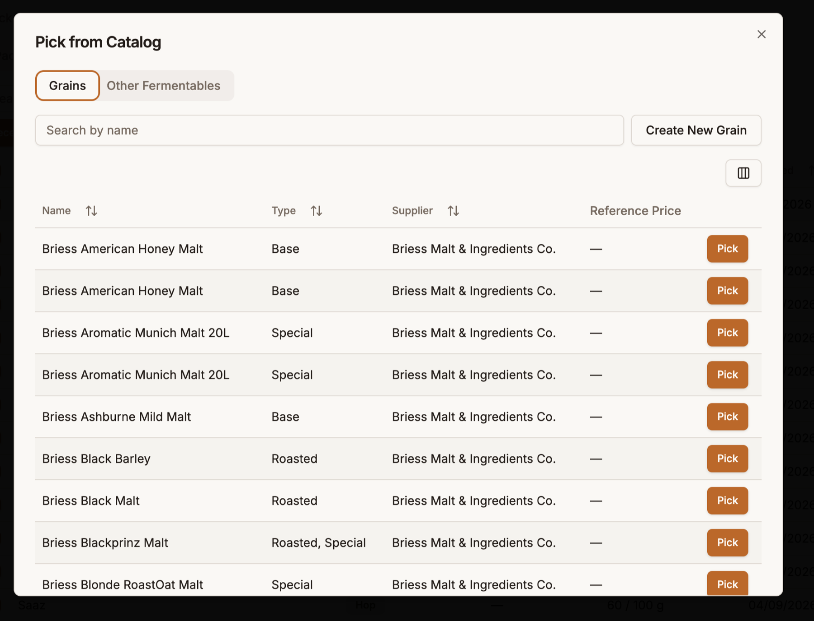

# Stock

The **Stock** page tracks what you actually have on hand — finished beer in kegs, cans and bottles, and the raw ingredients waiting to be brewed. It's separate from [Inventory](inventory.md), which is your reference catalogue of ingredient specs and prices: Inventory says *what* an ingredient is, Stock says *how much of it you have*.

It has two tabs, **Packaged Product** and **Raw Materials**. You'll only see the Stock page if your role has stock permissions (see [Tenant Administration](tenant-administration.md)).

## Packaged Product

Every row is one **package type from one batch** — for example "3 × 19 L kegs of Fresh Hop Saison, batch 20260819-01". Columns show:

- **Beer / Batch** and **Type** (Keg, Can, Bottle, Other)
- **Volume Each** and **Cost Each**
- **On Hand** — what's left, out of how many were packaged (e.g. `2 / 3`)
- **Packaged** date and **Best Before** date

Use the search box and filters (stock status, best before, packaged date range, package type) to narrow the list. The **Columns** button shows or hides columns. The print icon opens a printable stock report (see below).

### How stock gets here

Stock is created deliberately, never automatically. Once a [brew session](brew-sessions.md) is **Packaged**, open its **Packaging** tab, add your packaged items, and click **Save to Stock** — each package line becomes a stock row, with its cost per unit captured at that moment. See [Packaging and stock](brew-sessions.md#packaging-and-stock).

### Opening an item

Click a row to open its detail dialog.

At the top you'll see the on-hand count, volume each, cost each, and who packaged it and when. From here you can:

- **Set a Best Before date** — type one in, or use the **+6 mo / +1 yr / +18 mo** shortcuts — and add **Notes**.
- **Record a movement** — every time beer leaves stock, record what happened. Pick a **Type**, a **Quantity**, an optional **Unit Price**, and the **Date**.
- **Review the history** of every movement, and edit or delete one if you made a mistake.

Which movement types you can choose depends on your account type:

| Account type | Movement types |
|---|---|
| Commercial brewery | Sold, Given away, Written off, Spoiled |
| Homebrewer | Consumed, Given away, Written off |

On a Commercial account, a **Sold** movement also has a **Customer** picker — choose one of your [customers](accounts.md#customers), or leave it as *Anonymous / cash sale* for taproom and walk-up sales. These movements are also what feeds the [Excise report](accounts.md#excise).

You can't remove more than you have: a movement that would take the on-hand count below zero is rejected.

### Change log

Click the **history** icon in the dialog header to open the **Change Log**: a permanent, append-only record of who changed what and when — the item being created, best-before edits, and every movement recorded, edited or deleted.

The change log is kept even if a movement is later deleted, so it's a reliable audit trail.

### Archiving and deleting

- **Archive** (the box icon in the dialog header) hides an item from the default list — handy for a keg that was sold long ago. Archived stock stays reachable from **View Archived Stock**, and you can unarchive it any time. Archiving never loses anything.
- **Delete** is only offered for an item that has never had any activity (no sales, giveaways or adjustments). Once there's history, archive it instead.

### Printing a stock report

The print icon opens a **Print Preview** of the **Packaged Product Stock Report** for whatever your current filters show — with your brewery name and logo, the date printed, and a total item count. It's meant for stocktakes and for handing to an accountant.

## Raw Materials

The **Raw Materials** tab tracks ingredient **lots** — a specific delivery of malt, hops, yeast or adjuncts — so you know what's on hand and which batches used it.

Each row shows the ingredient, its **Category** (Fermentable, Hop, Yeast or Adjunct), **Lot Code**, **On Hand** (remaining out of received, e.g. `55 / 100 g`), and the **Received** and **Best Before** dates. Filter by stock status, best before, received date range and category, or search by ingredient name or lot code. **View Archived Stock** and the print icon work just as they do for packaged product.

### Receiving stock

Click **Receive Stock** when a delivery arrives.

- **Category** and **Ingredient Name** — required. Click the **link** button beside the name to pick the ingredient from your catalogue instead of typing it; linking means BrewIQ can match the lot to recipes and prices.
- **Quantity Received** and **Unit** — required.
- **Price per unit** — optional. When the lot is linked to a catalogue ingredient, you can tick **Update this item's inventory price** to also save this price as your brewery's price in [Inventory](inventory.md).
- **Lot Code**, **PO Reference** and **Supplier** — optional, but worth filling in for traceability.
- **Lot AA%** — for hops, the alpha acid percentage of this particular lot.
- **Received Date** (defaults to today) and **Best Before**, with the same **+6 mo / +1 yr / +18 mo** shortcuts.
- **Notes**.

If the ingredient isn't in the catalogue yet, the picker lets you create it on the spot (for example **Create New Grain**).

### Lot details, traceability and audit

Click a lot to see its detail dialog. You can edit its best-before date, notes and (for hops) **Lot AA%**, record movements such as adjustments, and see **which brew sessions used the lot**. As with packaged product, every change is written to a **Change Log**, and a lot can only be deleted before it has any activity — otherwise archive it.

Lots are consumed by linking them to ingredients in a brew session — see [Linking stock to a brew session](brew-sessions.md#linking-stock-to-a-brew-session).
